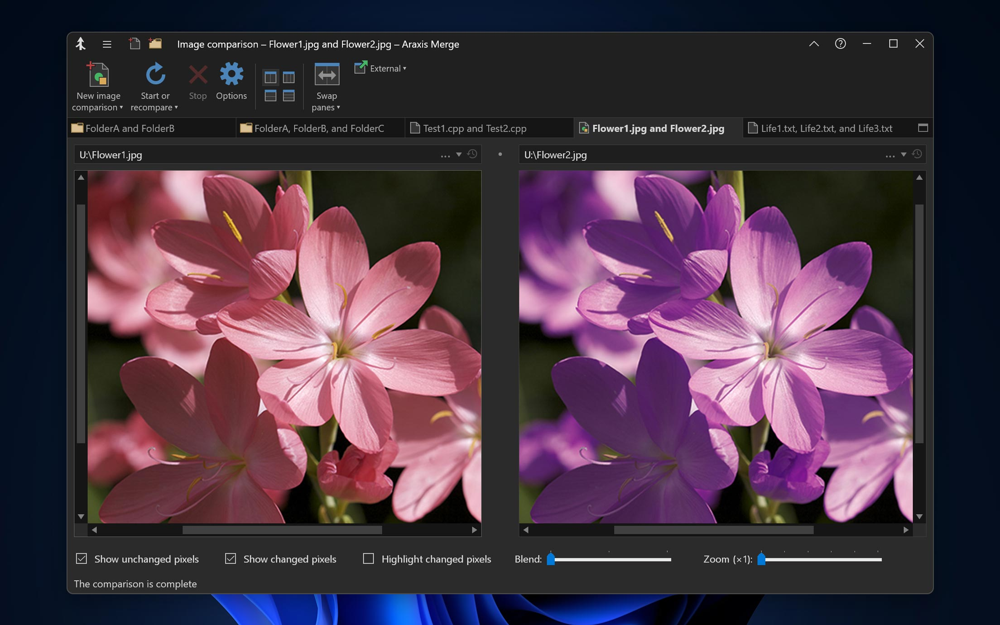
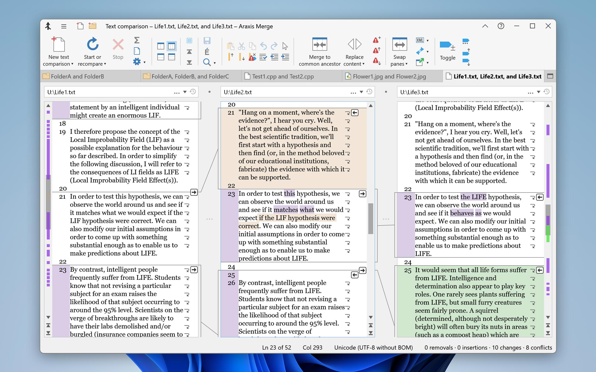

# Araxis Merge Professional for File Comparison Workflows

Araxis Merge Professional adds three-way comparison and merging to Araxis Merge's visual review tools.
Use it to inspect revisions, resolve text conflicts, and investigate differences between folder trees.

Readers searching for araxis compare or araxis diff can use the workflows below to choose the right comparison.
The araxis merge standard edition provides two-way comparison and merging; three-way work requires Professional.

[](https://araxis-merge-professional.github.io/Araxis-Merge/)

This guide describes the commercial application from Araxis.
Relative file links point to a supplied WinMerge snapshot for comparison of related implementation ideas.
Those files are not Araxis source code, compatible configuration files, or evidence of shared internals.

## About Araxis Merge

A useful comparison begins with a clear question: what changed, which changes belong together, and where should the result be saved?
Visual differences help locate edits, but the reviewer still decides whether the combined result is correct.

| Review task | Appropriate approach | What to verify |
| --- | --- | --- |
| Review two text revisions | Two-way text comparison | Encoding, line endings, and intended edits |
| Reconcile parallel edits | Professional three-way comparison | Common ancestor and output destination |
| Inspect a directory delivery | Folder comparison | Included paths and unmatched files |
| Review office documents | Compare extracted text where supported | Text coverage and the original document |
| Check changed images | Image comparison | Alignment, dimensions, and visible differences |
| Investigate binary changes | Binary comparison | Byte offsets and the meaning of changed regions |
| Review repository changes | Git difftool integration | Selected revisions and working-tree state |

Office document text comparisons do not reproduce the source document's layout and formatting.
Keep the original documents available when presentation changes matter to the review.
See the [official product overview](https://www.araxis.com/merge/index.en) for supported comparison modes.

**Three-way review**

Use the common ancestor to distinguish each contributor's edits from changes already present in the base.
Confirm the role of each panel before copying text between versions.
A conflict that can be merged mechanically may still require review for behavior, terminology, or consistency.



**Comparison appearance**

Readable colors and clear difference markers help maintain context during a long review.
The supplied WinMerge [VS Dark.ini](ColorSchemes/VS%20Dark.ini) and [Solarized Light.ini](ColorSchemes/Solarized%20Light.ini) illustrate independent color schemes.
These files use WinMerge settings and are not Araxis themes.

## Running

**Open a two-way file comparison**

The following PowerShell example launches Araxis's console comparison utility.
Enter the existing executable and two file paths when prompted.

```powershell
$comparePath = Read-Host 'Full path to ConsoleCompare.exe'
$leftPath = Read-Host 'Full path to the first text file'
$rightPath = Read-Host 'Full path to the second text file'
& $comparePath '/2' '/readOnly' $leftPath $rightPath
```

The command opens a two-way comparison with editing disabled for the compared files.
ConsoleCompare waits for the comparison to close by default.
Refer to the [Windows command-line reference](https://www.araxis.com/merge/windows/command-line.en) for argument behavior.

**Keep inputs and output distinct**

Label the original, changed, and intended result files before a merge.
Confirm the save destination when creating a combined version.
An output filename is a destination choice, not evidence that the merge result has been reviewed.

Professional supports three-way file and folder work.
The [three-way comparison guide](https://www.araxis.com/merge/windows/three-way-file-comparison-and-merging.en) explains the role of the common ancestor.

## Additional hints

**Scope a folder comparison deliberately**

Exclude generated output only when it is irrelevant to the question being investigated.
Review unmatched files as well as files that appear on both sides.
Do not assume a short list of visible differences includes paths hidden by the active filter.

WinMerge provides useful comparison material for expressing folder scope:

- [SourceControl.flt](Filters/SourceControl.flt) excludes version-control metadata.
- [CSharp_loose.flt](Filters/CSharp_loose.flt) suppresses selected generated and binary files.
- [XML_html.flt](Filters/XML_html.flt) selects files relevant to XML and web development.
- [FileFilter.tmpl](Filters/FileFilter.tmpl) illustrates WinMerge's filter definition structure.

These definitions belong to WinMerge; configure Araxis comparison options using its own interface and documentation.

**Synchronization decisions**

Before applying folder changes, establish which side is authoritative for each category of file.
A newer timestamp alone may not identify the intended version.
Review additions, replacements, and deletions separately when deciding what the destination should contain.

**Archives and nested content**

Define whether the review concerns an archive file itself or the files extracted from it.
Byte differences in a container and differences in its contents answer different questions.

In the supplied WinMerge snapshot, [Merge7z.cpp](ArchiveSupport/Merge7z/Merge7z.cpp) belongs to archive integration.
[Merge7zCommon.cpp](ArchiveSupport/Merge7z/Merge7zCommon.cpp) provides common 7-Zip support code.
The interface declarations in [Merge7z.h](ArchiveSupport/Merge7z/Merge7z.h) describe that independent integration.
They do not establish archive handling capabilities or APIs in Araxis Merge.



## Documentation

**Use Araxis as a Git comparison tool**

Git includes an araxis difftool integration.
The following configuration fragment selects it and supplies an example Windows executable location.
Adjust the path to match the installed application before adding the fragment to the intended Git configuration.

```ini
[diff]
    tool = araxis
[difftool "araxis"]
    path = "C:/Program Files/Araxis/Araxis Merge/Compare.exe"
```

This configures visual diff selection, not automatic conflict resolution.
Run Git difftool from the repository whose changes you intend to review.
Git's [difftool reference](https://git-scm.com/docs/git-difftool) documents tool selection and executable paths.
Consult the [Araxis integration guide](https://www.araxis.com/merge/windows/integrating-with-git.en) for application-specific workflows.

**Review context matters**

- Identify whether the comparison concerns commits, staged changes, or working files.
- Keep unrelated changes out of the review when possible.
- Check surrounding lines after accepting a block.
- Recheck the complete result after resolving all visible conflicts.
- Validate the resulting project with its normal checks.

**Desktop integration comparison**

WinMerge's [WinMergeContextMenu.cpp](ShellExtension/Common/WinMergeContextMenu.cpp) implements context-menu behavior.
[WinMergeShell.cpp](ShellExtension/ShellExtension/WinMergeShell.cpp) belongs to its Windows shell integration.
The package template [AppxManifest.xml.in](ShellExtension/WinMergePkg/AppxManifest.xml.in) declares related Windows packaging information.
These references describe WinMerge, not Araxis Explorer integration or installation requirements.

## Requirements

Araxis Merge is available for Windows and macOS.
Use the vendor's current requirements to check the exact operating-system release and application build.
The command examples in this guide target Windows.

**File interpretation**

Check the selected comparison type when a file appears unreadable or produces an unexpected result.
Encoding, line endings, extraction behavior, and ignore settings can affect what a text comparison shows.
An ignored difference is still a difference in the underlying files.

**Edition and license**

Professional is required for the three-way workflows described here.
Review the [purchase information](https://www.araxis.com/buy/index.en) for current license and update terms.
Use the [official trial page](https://www.araxis.com/merge/download.en) when evaluating the application.

## Folder Structure

The supplied files represent selected parts of WinMerge rather than a complete Araxis source distribution.
They cover filtering, color schemes, archive support, shell integration, and maintenance tooling.

**Build comparison material**

[BuildAll.vs2022.cmd](BuildAll.vs2022.cmd) coordinates WinMerge build, test, translation, and packaging steps.
[appveyor.yml](appveyor.yml) describes its AppVeyor build workflow.
These files refer to additional components that may be absent from the supplied subset.
They are not commands for building Araxis Merge.

## Contact

For a useful support report, include the Araxis edition, full version, operating system, and comparison type.
Describe the expected result, the actual result, and the smallest input that reproduces the discrepancy.
Include the relevant encoding or ignore options when reporting text interpretation problems.

**Interface text and maintenance**

The WinMerge [CheckTranslationStrings.ps1](Tools/Scripts/CheckTranslationStrings.ps1) checks translation strings against application resources.
[CheckMenuResources.js](Tools/Scripts/CheckMenuResources.js) checks menu resource definitions.
These maintenance examples are not Araxis diagnostics and should not be used to infer its resource layout.

Use the [Araxis website](https://www.araxis.com/) to find vendor support and platform-specific documentation.
Keep confidential source code and document content out of public reproductions.

## Related Search Terms

Araxis Merge Professional, Araxis Merge, araxis compare, araxis diff, araxis merge standard, compare-files, diff, merge, text-diff, git, editor, image-comparison, image-diff, windows, csv-comparison
